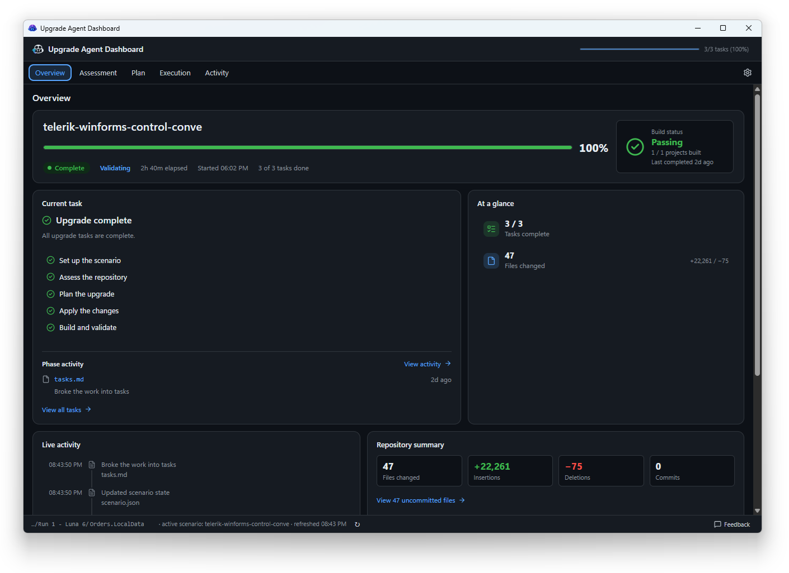
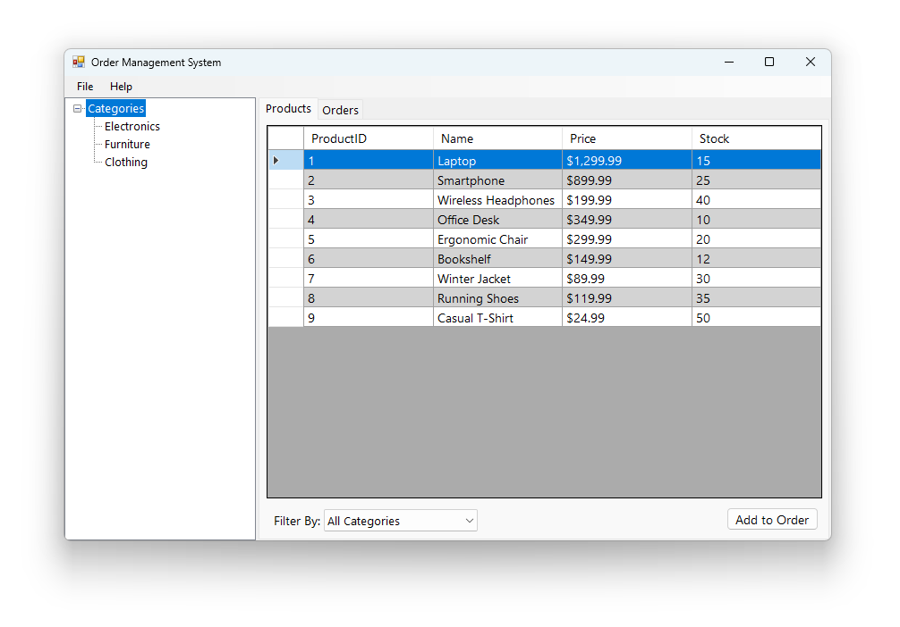
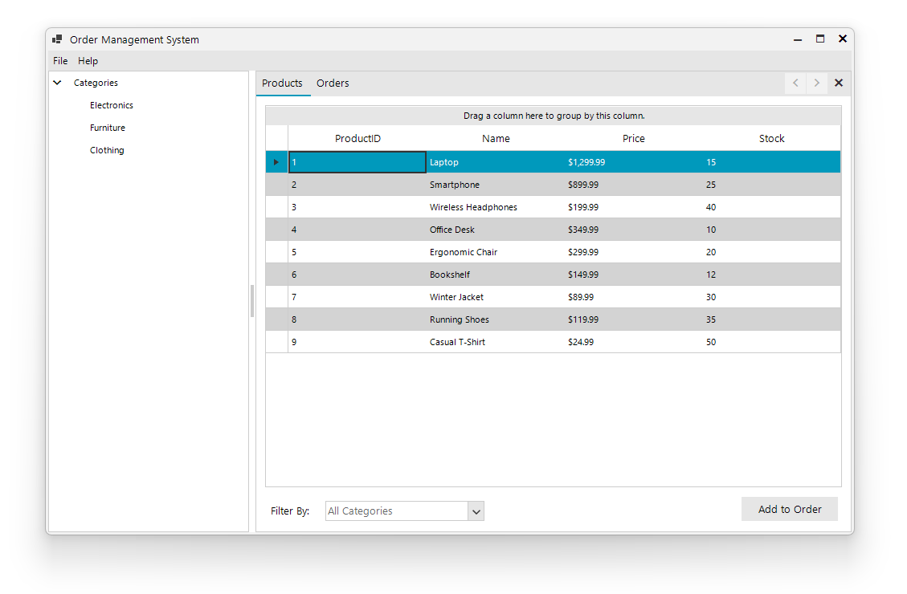

# WinForms Modernization Sample

This folder contains two versions of the same Order Management System application. Together, the projects demonstrate an end-to-end WinForms modernization workflow that combines Microsoft's GitHub Copilot Upgrade Agent with the Telerik WinForms Upgrade Plugin.

The sample shows how an existing application can be moved from .NET Framework 4.6.2 to .NET 10 and then modernized further by replacing standard Microsoft WinForms controls with Telerik UI for WinForms controls.

## Projects

The folder contains:

- **Original application**: A .NET Framework 4.6.2 WinForms project that uses standard Microsoft controls.
- **Modernized application**: An upgraded .NET 10 WinForms project in which the Microsoft controls have been converted to Telerik UI for WinForms controls.

The projects are retained side by side so that the original and modernized implementations can be reviewed and compared.

## Modernization Workflow

The modernization was performed in two main stages:

1. **Upgrade the target framework**

   Microsoft's GitHub Copilot Upgrade Agent was used to assess the original .NET Framework 4.6.2 project, create an upgrade plan, apply the required changes, and migrate the application to .NET 10.

2. **Convert the UI controls**

   The Telerik WinForms Upgrade Plugin was used to convert the standard Microsoft WinForms controls to Telerik UI for WinForms controls. The plugin extends Microsoft's Upgrade Agent with Telerik-specific modernization workflows, including control conversion, Telerik package configuration, licensing setup, and validation.

This separation is intentional: when the modernization includes a change to the application's .NET target, the Microsoft `dotnet-version-upgrade` scenario should run first. The resulting target framework then determines which Telerik UI for WinForms versions are available before the Telerik-specific conversion or version-upgrade workflow runs.

## Upgrade Process

The sample was modernized by running the Upgrade Agent in **automatic mode**  to upgrade the project to .NET 10 and also convert the UI components to Telerik. After the modernization request was provided, the agent performed the assessment, generated the plan, and executed the required changes without requiring manual approval at every stage.

At a high level, the process was:

1. Open the original .NET Framework 4.6.2 solution with GitHub Copilot Upgrade available.
2. Run the Microsoft Upgrade Agent in automatic mode and request an upgrade to .NET 10.
3. Allow the agent to assess the project, generate the upgrade plan, and apply the required framework and project-system changes.
4. Build and verify the upgraded .NET 10 project.
5. In automatic mode, follow with conversion of the standard Microsoft WinForms controls to Telerik UI for WinForms controls.
6. Allow the agent to perform the Telerik-specific assessment, generate the conversion plan, configure the required Telerik packages and licensing.
7. Convert the UI controls to Telerik using the Telerik WinForms MCP Server.
8. Perform additional UI changes where necessary, consult the component assistant from the same Telerik WinForms MCP Server.
9. Build, run, and validate the resulting application.

Although automatic mode executes the workflow with minimal intervention, the generated assessment, plan, changes, and final application should still be reviewed and validated. The exact tasks generated by the Upgrade Agent depend on the structure and dependencies of the project being modernized.

## Upgrade Agent Dashboard

During a local modernization run, the Upgrade Agent dashboard presents the active scenario, lifecycle phases, generated tasks, assessment results, project and dependency information, incidents, and execution activity.

## Original Application

The original application targets .NET Framework 4.6.2 and uses standard Microsoft WinForms controls.

## Modernized Application

The modernized application targets .NET 10 and uses Telerik UI for WinForms controls. The application preserves the original Order Management System functionality while demonstrating the converted Telerik user interface, including the product grid, category navigation, tabs, filtering, and order actions.

## Prerequisites

Depending on the environment used to reproduce the modernization, the following may be required:

- GitHub Copilot with access to GitHub Copilot Upgrade
- The Microsoft Upgrade Agent installed and available in the selected host
- The Telerik WinForms Upgrade Plugin installed and enabled
- GitHub Copilot CLI
- A .NET SDK capable of building the target .NET 10 project
- A Telerik account with an active DevCraft or Telerik UI for WinForms license, or a trial license

For the precise and current prerequisites, use the installation documentation linked below.

## Resources

- [Telerik WinForms Upgrade Plugin source](https://github.com/telerik/ai-plugins/tree/main/plugins/telerik-winforms-upgrade-plugin)
- [Telerik WinForms Upgrade Plugin overview](https://www.telerik.com/products/winforms/documentation/ai-tools/upgrade-plugin/overview)
- [Microsoft Upgrade Agent plugins](https://github.com/microsoft/upgrade-agent-plugins)
- [Install GitHub Copilot Upgrade](https://learn.microsoft.com/en-us/dotnet/core/porting/github-copilot-upgrade/install?pivots=github-copilot-app)

## Notes

- The projects are demonstration samples and are intended for comparing the application before and after modernization.
